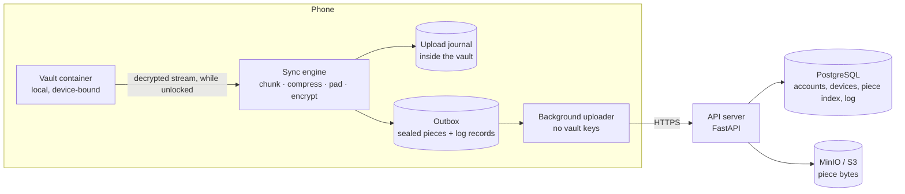

# Sync Design

**Status:** M1 server and the M2 sync engine core are built and tested ([server/](../server/README.md), [packages/sync_core](../packages/sync_core)); not yet wired into the app. Threat model: [THREAT_MODEL.md](THREAT_MODEL.md).
On-device format: [CONTAINER_FORMAT.md](CONTAINER_FORMAT.md).

**Problem:** get material off a phone and onto a server the user trusts, over
connections that are slow and keep dropping, without the server being able to
read it. Then restore it on another phone, and keep it safe if a phone is lost
or seized.

## 1. Goals and non-goals

**Goals**
1. **End-to-end encryption.** The server stores ciphertext only; keys live on
   the user's devices and in their recovery phrase.
2. **Progress survives anything.** A dropped connection, an app kill or a
   reboot loses at most the piece that was in flight.
3. **Smallest useful upload first.** A watchable preview reaches the server
   long before the full original.
4. **Restore and recovery.** A new phone can restore everything. A lost or
   seized phone can be cut off.
5. **Version history**, with clear rules for deletes and conflicts.
6. **Don't weaken the on-device protections**: decoy deniability and the cover app.
7. **Measured, not claimed.** Every reliability property has a failure test
   and a number.

**Non-goals (for now):** real-time collaboration, sharing with other people,
Tor, iOS background upload, using third-party clouds directly.

## 2. Where sync sits

Sync is a layer *on top of* the vault. The container stays a local format; it
is never uploaded as a file (see §13 for why).



The sync engine itself (chunking, encoding, journal, scheduling logic) is a
**pure-Dart package** (`packages/sync_core`), so it runs in the Flutter app
and in a headless CLI used by the failure-test harness and CI.

## 3. Keys and identities

| Secret | What it is | Where it lives |
|---|---|---|
| **RS** (recovery secret) | 256 random bits, shown once as a 24-word phrase (BIP-39 wordlist) | Paper, memory, or a trusted editor. **Never stored on a device.** |
| **SRK** (sync root key) | 256 random bits per vault, per epoch | Inside that vault's encrypted index; on the server only wrapped under RS |
| **Device key** | Ed25519 keypair, generated on each phone | Sealed under a hardware keystore key (§9) |
| **Recovery key** | Ed25519 keypair derived from RS | Derived on demand when the phrase is typed in; never stored |

Derived from SRK (HKDF-SHA256, distinct `info` per purpose, epoch bound in):

| Key | Used for |
|---|---|
| `K_cdc` | Seeds the chunker, so piece boundaries depend on a secret |
| `K_id` | Piece names: `id = HMAC-SHA256(K_id, plaintext)` |
| `K_piece` | Encrypting pieces |
| `K_manifest` | Encrypting file manifests |
| `K_log` | Encrypting change-log records |

Derived from RS: `K_wrap` (wraps SRK for the server-side escrow) and the
recovery keypair (registers and revokes devices).

**Why RS isn't kept on the phone:** a seized phone with the real PIN gives an
attacker SRK, so they can read the data, but not RS. Without RS they can't
re-register themselves once revoked, rotate keys, or delete data in
append-only mode.

## 4. Turning files into pieces

1. **Chunking.** FastCDC content-defined chunking with min 64 KiB, average
   256 KiB and max 1 MiB. The gear table is generated from `K_cdc`. Unkeyed
   chunking would let piece sizes fingerprint known files.
2. **Naming.** `id = HMAC-SHA256(K_id, plaintext piece)`. The same content
   always gets the same name, so it is uploaded once (deduplication), but the
   server can't compute names for content it wants to look for.
3. **Compression.** zstd only for compressible types (text, notes, documents,
   manifests), and kept only if it saves at least 10%. Photos, video and audio
   are already compressed and are sent as-is.
4. **Padding.** Plaintext = `codec(1) ‖ length(4) ‖ data ‖ zeros`, padded to
   the Padmé size for its length. This costs at most ~12% and leaves sizes
   that carry very little information.
5. **Encryption.** `seal(K_piece, padded, aad = "piece" ‖ id)`, using AES-256-GCM.
   The AAD binds each ciphertext to its name, so the server can't serve one
   piece under another's name. The nonce is **deterministic, SIV-style**:
   `HMAC(K_nonce, aad ‖ SHA-256(padded))[0:12]`. Sealing the same bytes
   again gives identical ciphertext, so an interrupted upload can resume
   byte-for-byte even after an app restart, and every device produces the
   same digest for the same piece. A nonce can only repeat for byte-identical
   input, so it's never reused for different plaintext. (It reveals that
   two pieces are equal, which content naming already reveals.)
6. **Verification on read.** After decrypting, the client recomputes the
   name from the plaintext and checks it matches, so a valid ciphertext of
   *other* content stored under this name is still refused.

Pieces are **immutable** and **named by content**. That one property gives us
resumability, safe retries and deduplication without per-upload server state.

## 5. Manifests and previews

A **manifest** describes one version of one file. It is sealed under
`K_manifest` and stored as a piece itself:

```json
{
  "file": "<uuid>", "version": "<uuid>", "parent": "<version uuid | null>",
  "role": "original | preview", "previewOf": "<version uuid | null>",
  "meta": { "title": "...", "mime": "...", "category": "...", "created": "...", "tags": [] },
  "size": 123456789,
  "mac": "<HMAC-SHA256(K_id, whole plaintext file)>",
  "pieces": [["<id>", 262144], ["<id>", 198330]]
}
```

`mac` lets a restore verify the reassembled file end to end. Notes under
16 KiB are inlined in the manifest, which saves a round trip.

**Previews** are separate files with `role: "preview"`, made on the phone
before upload. Rough targets, to be tuned by measurement:

| Source | Preview | Typical reduction |
|---|---|---|
| Phone video (1080p, ~15–20 Mbit/s) | 480p H.264 ~600 kbit/s + AAC 64 kbit/s (Android Media3 Transformer) | ~25× |
| Photo (3–5 MB) | 1600 px long edge, JPEG q75 | ~10× |
| Audio recording | Mono AAC ~32 kbit/s | ~4–5× |

The preview is evidence that *arrives*. The original keeps full quality and
metadata for verification, and follows later.

## 6. The change log

The server keeps an append-only log per account. Each record is sealed under
`K_log`:

```
record body = { device, counter, prevHash, time, ops: [...] }
ops         = PUT{file, version, manifestId, parent}
            | DEL{file, version}
            | CHECKPOINT{stateManifestId}
sealed with aad = "log" ‖ device ‖ counter
```

- **Per-device chains:** each device numbers its own records (`counter`) and
  links each to the previous one (`prevHash`). A record never depends on
  other devices' state, so it can be **sealed in advance** while the vault is
  unlocked and appended later by the background uploader (§9).
- The server assigns a global `seq` for paging (`GET /log?after=seq`) and
  rejects a `counter` that isn't the device's next one (409).
- **Tamper detection:** a missing counter or a broken `prevHash` link means
  the server dropped or reordered records, and the client raises an alarm.
  Withholding the *newest* records is only detectable against a state the
  client has already seen. That's the usual limit without a trusted third party.
- **Checkpoints:** a periodic CHECKPOINT points to a manifest listing the full
  current state, so a new device doesn't replay years of log.

## 7. Server API (v1)

All bodies are opaque ciphertext except where noted. Requests carry a
short-lived bearer token obtained by signing a server challenge with the
device key.

| Method & path | Purpose |
|---|---|
| `POST /v1/accounts` | Create an account from an invite code. Body: the 4 recovery public keys (§11) |
| `POST /v1/auth/challenge` · `POST /v1/auth/token` | Challenge-response login with the device key |
| `POST /v1/devices` | Register a device. Authorised by a recovery-key signature or a one-time pairing code |
| `DELETE /v1/devices/{id}` | Revoke a device (recovery-key signature) |
| `POST /v1/pairing` · `…/{code}/exchange` | One-time pairing code; relays an X25519 key exchange so SRK never appears in a QR image |
| `GET/PUT /v1/escrow` | 4 fixed escrow slots holding SRKs wrapped under each vault's RS (writes need a recovery-key signature) |
| `POST /v1/pieces/missing` | Body: up to 500 ids. Returns the ones the server doesn't have |
| `PUT /v1/pieces/{id}` | Upload one piece. Idempotent: `201` new, `200` already stored. Request carries `Content-Digest: sha-256=…`; the server verifies it and echoes the stored digest |
| `GET /v1/uploads/{id}` · `PATCH /v1/uploads/{id}` | Resume *within* a piece: the server reports how many bytes it holds; `PATCH` appends a part at `Upload-Offset` (409 with the right offset if wrong). Once `Upload-Length` is reached, the whole piece must match `Piece-Digest` (else 422 and the partial data is discarded) before it is committed |
| `GET /v1/pieces/{id}` | Download, with `Range` support for resuming |
| `GET /v1/pieces?after=…` | Paged listing (id, size, created), used for pruning |
| `POST /v1/pieces/delete` | Delete unreferenced pieces. Refused for device tokens in append-only mode |
| `POST /v1/log` · `GET /v1/log?after=seq` | Append a record / read records |

Storage: PostgreSQL holds accounts, devices, tokens, the piece index
(`account, id, size, sha256, created`) and the log. MinIO holds piece bytes
under `account/id`. Everything ships as a Docker Compose stack, so a newsroom
or NGO can run its own.

## 8. Upload pipeline

When a file is added (or a note saved) with the vault unlocked:

1. Stream the file out of the vault, chunk it, name the pieces and record the
   boundaries and ids in the **upload journal**. The journal is stored inside
   the vault and checkpointed every ~5 s or 2 MB, not on every piece.
2. Build the preview, if there is one, and chunk it the same way.
3. Seal pieces and log records into the outbox (§9), or upload directly if
   connected.
4. `POST /pieces/missing` in batches, then `PUT` only the missing pieces.
5. Upload the manifest, then append the log record. A file counts as backed
   up only once its log record is acknowledged.

**The server is the source of truth for which pieces exist.** If the journal
loses progress (crash between checkpoints), the next "missing?" query costs a
few hundred bytes and nothing is re-sent.

### 8.1 Riding short pockets of signal

| Mechanism | Detail |
|---|---|
| Wake on connectivity | `ConnectivityManager` callback starts work the moment a network appears; WorkManager with a network constraint is the backstop, with exponential backoff from 30 s to 15 min |
| Priority queue | Log records and manifests → previews → small originals → large originals. "Send now" moves an item to the front |
| Metered data | Previews go on any network; originals wait for unmetered by default (configurable) |
| Small units | A 256 KiB piece takes ~33 s at 64 kbit/s, ~5.5 s at 384 kbit/s and ~1 s at 2 Mbit/s. A drop costs at most the part in flight |
| Adaptive parts | A piece larger than the current part size goes up in parts appended at the server's offset. Every drop halves the part size (to 16 KiB); four quick successes double it (to 1 MiB). **Measured necessity:** with 2 s pockets at 64 kB/s, whole-piece uploads never completed (a piece needs ~4 s); with adaptive parts, 1 MiB arrived in 62 s against a 41 s theoretical minimum |
| Adaptive concurrency | Start with 1 piece in flight; add one (up to 4) after each run of quick successes; drop back to 1 on any failure |
| Connection reuse | One kept-alive HTTP/2 connection with TLS 1.3 session resumption, so a pocket doesn't spend its first seconds on handshakes |

### 8.2 Offload: "delete from this phone once it's safe"

This is opt-in, per item or globally. The local copy is deleted (with the
existing secure delete) only after:

1. The log record is acknowledged.
2. Every piece's stored SHA-256, as echoed by the server, matches what was sent.
   A piece that was *already* on the server (uploaded earlier, or by another
   device) was sealed with a different random nonce, so its digest won't match;
   those pieces are verified by downloading and decrypting them instead.
3. The manifest has been downloaded back, decrypted and compared.

If the vault is locked when this completes, the deletion is applied the next
time it is unlocked.

## 9. Decision D1: uploading while the vault is locked

Reading files and keys needs the vault unlocked, but pockets of signal come
while the phone is in a pocket. The options:

| Option | How | Cost |
|---|---|---|
| **A. Unlocked only** | Sync runs only while the vault is open | Misses most pockets. No extra trace on the phone |
| **B. Locked outbox** (recommended) | While unlocked, the engine pre-seals pieces and log records into an **outbox** of random-named files. A background uploader holding only a device credential uploads them. It never has SRK or file names | Pending material takes extra storage until sent (the outbox is capped, e.g. 2 GB; overflow waits for an unlock). A forensic examiner (A3) can see that an outbox and a credential exist, and how much is pending, but not which vault it belongs to or what it contains |

The background credential is sealed under a hardware keystore key that needs
no user authentication (`u0`). An examiner with root can therefore recover the
server address and device credential. This is why **one account per phone,
shared by all its vaults** (§11) matters: the credential reveals that the phone
backs up, not how many vaults it has.

Users who want the strongest deniability can turn B off and run in mode A.

## 10. Restore, pairing and losing a phone

**New phone, old phone in hand (pairing):** the old phone asks for a one-time
pairing code and shows a QR code (server, account, code). The new phone
registers, and the two run an X25519 key exchange relayed by the server. The
old phone then sends SRK encrypted to the new phone. SRK never appears in the
QR image itself.

**Old phone gone (recovery):** on a new phone, enter the server address and
the 24-word phrase. The phrase derives the recovery key, which registers this
device, and `K_wrap`, which unwraps SRK from the escrow by trial decryption.
Then the phone reads the log from the latest checkpoint, downloads previews
first if bandwidth is poor, then originals (with `Range` resume), and checks
each file's `mac` before importing it into the local vault.

**Phone seized:**
1. On another device, type the phrase and revoke the seized device, plus any
   device you don't recognise in the list (the seized phone could have paired
   one before you acted). The server refuses their credentials from then on,
   and the attacker can't re-register because they don't have RS.
2. Rotate SRK to a new epoch, wrapped under RS. Everything uploaded afterwards
   is under keys the seized phone never had.
3. Anything the seized phone could already read (its own vault, and data it
   had downloaded) stays exposed. Revocation stops future access only.

## 11. Decoys and sync

This mirrors the container's "4 records, can't tell how many are used":

- **One sync account per phone**, shared by every vault on it. The server and
  the on-phone credential see one account either way.
- Each vault has its own RS, SRK and key set, so pieces and log records from
  different vaults can't be told apart.
- The account always has **exactly 4 recovery public keys** and **4 escrow
  slots**. Unused keys are real Ed25519 keys whose private half was discarded;
  unused escrow slots are random bytes.
- The decoy can sync too, ideally with believable content, so "yes, I back up
  this app" is a complete answer.
- **Remaining tell:** someone who forces their way into the *account* (not
  just the phone) can compare the total stored volume with what the decoy's
  manifests reference. Append-only mode and an org-run server reduce exposure;
  they don't remove it.

## 12. Versions, deletes, conflicts, pruning

- **Versions:** every PUT is a new version; pieces are shared between versions.
  History is the log.
- **Deletes:** a DEL hides the file. Its pieces stay until pruning, after a
  retention period (default 30 days).
- **Conflicts:** photos, video and audio never change after capture, so only
  notes can conflict. Two versions with the same parent → keep both and show
  a "conflict copy". Delete vs. edit → the edit wins (never lose data silently).
- **Pruning:** a device with SRK computes the live piece set from the log and
  checkpoints, lists the server's pieces, and deletes unreferenced ones older
  than the retention period. Only clients can do this; the server can't see
  references.
- **Append-only mode** (server setting, recommended for newsrooms): device
  tokens can upload but never delete. Pruning needs a recovery-key signature.
  A seized phone can't erase what has already reached the server.

## 13. Alternatives considered

| Alternative | Why not (for now) |
|---|---|
| Upload the container file | Gigabytes, mostly random filler, device-bound by design, and any change rewrites chunks all over the file |
| tus for whole files | Built for one large object with per-upload server state. Small immutable content-named pieces give resume, idempotency and dedup for free. A tus-like offset protocol is used only *within* a piece (`/v1/uploads`), where measurements showed it's needed |
| Pack files (as in restic) | Fewer requests and hidden piece sizes, but a drop loses a bigger unit, and pruning needs repacking. Revisit if per-request overhead dominates the measurements |
| Plain SHA-256 piece ids / convergent encryption | Lets the server confirm you hold a known file |
| Unkeyed content-defined chunking | Piece sizes fingerprint known files |
| Compress everything | Media is already compressed; it would burn battery for ~0–3% |
| Use Google Drive / S3 directly | Possible later behind the same piece/log interface, but append-only and device revocation need a server we control |

## 14. Failure testing and measurements

The harness runs the headless Dart client against the Docker Compose stack
through **Toxiproxy** (bandwidth caps, latency, connection resets, timeouts,
data limits), plus `tc netem` in a Linux container for packet loss.

**Network profiles:** good 4G (10 Mbit/s, 50 ms) · poor 3G (384 kbit/s,
300 ms, 2% loss) · EDGE (64 kbit/s, 600 ms) · "pockets" (connected 20 s,
dropped 60 s, repeating).

**Scenarios**
- Kill uploads at random byte offsets, 1,000 runs per profile.
- Replay every request twice (idempotency).
- Flip bits in stored pieces in MinIO; the client must refuse the file.
- Two clients edit the same note offline, then sync.
- Lose the phone: restore from the phrase alone; revoke; confirm the old
  credentials fail.
- The server drops or reorders log records; the client must alarm.

**Metrics reported in the README:** wire bytes ÷ payload bytes; bytes wasted
per interruption, against restart-from-zero and against tus; time to first
safe copy (preview + log acknowledged) per profile; time to full sync; restore
integrity (SHA-256 match, target 100%); bytes saved by deduplication on
re-import.

No number goes in the README or a résumé until the harness has produced it.

## 15. Milestones

| # | Deliverable |
|---|---|
| M0 | Commit the container work; test it on a real phone (keystore, decoy). **Done: core and UI flow pass on a Galaxy M34 (Android 16). Gesture and fingerprint unlock were removed; unlock is PIN-only** |
| M1 | Server skeleton (Compose: FastAPI, Postgres, MinIO), piece + log API, Toxiproxy harness, CLI client that backs up a folder. **Server + API + 21 tests done; Compose file written but not yet run; harness and CLI client pending** |
| M2 | `sync_core`: keyed chunking, piece encoding, journal, scheduler logic; integrated into the app in mode A. **Engine done and tested end to end against the server through a failure-injecting proxy; app integration and the Android scheduler pending** |
| M3 | Restore, recovery phrase, pairing, revocation, SRK rotation |
| M4 | Previews (Media3 Transformer for video, image downscale, audio) |
| M5 | Locked outbox (mode B) and offload |
| M6 | Version history UI, pruning, append-only mode; measurements published |

## 16. Open questions

1. Piece size: measure 128 / 256 / 512 KiB averages on each profile before fixing a default.
2. ~~Below ~50 kbit/s, do drops inside a piece dominate?~~ **Answered: yes.** Short pockets never fit a whole piece; resume within a piece was added (§7, §8.1).
3. Is HTTP/3 (QUIC) worth it on lossy links? Measure before adopting.
4. Tor / onion-service support for the server connection.
5. How to show offloaded items: a placeholder reveals they existed, while showing nothing is cleaner for deniability. Probably a setting.
6. zstd in Flutter: a well-maintained FFI binding, or fall back to the built-in zlib.
7. Recovery-phrase wordlists beyond English (Arabic, Ukrainian, Pashto, …) for the people this is for.
